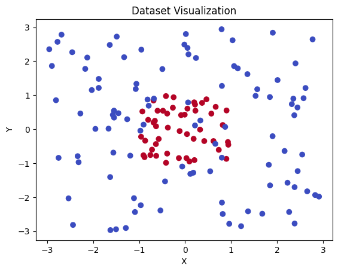
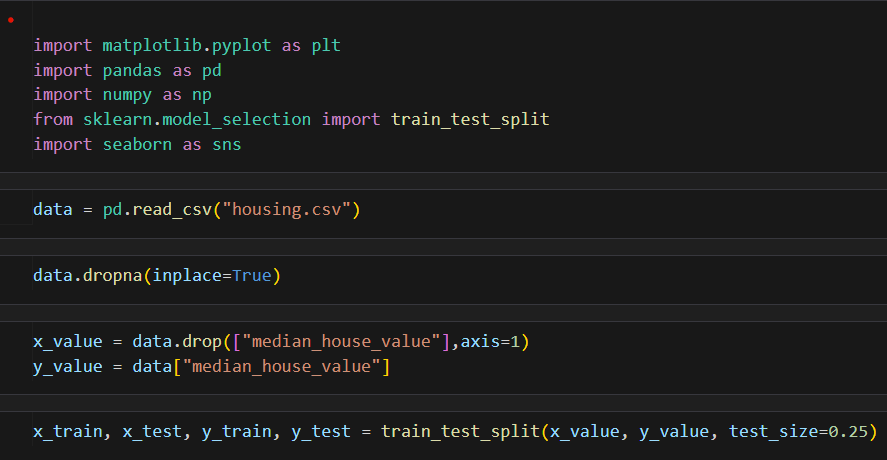
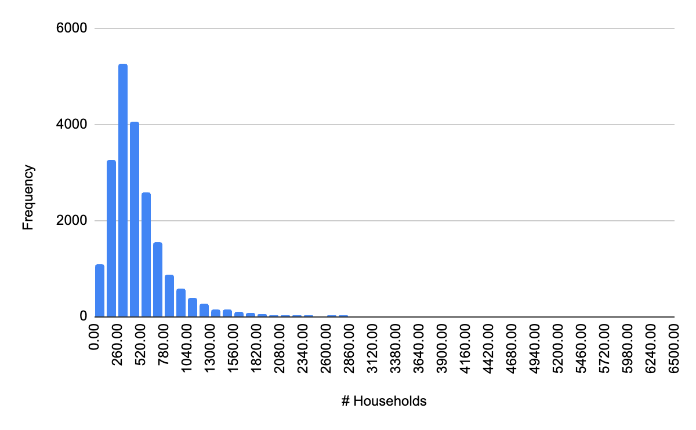
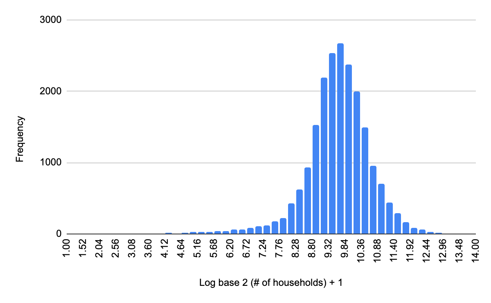
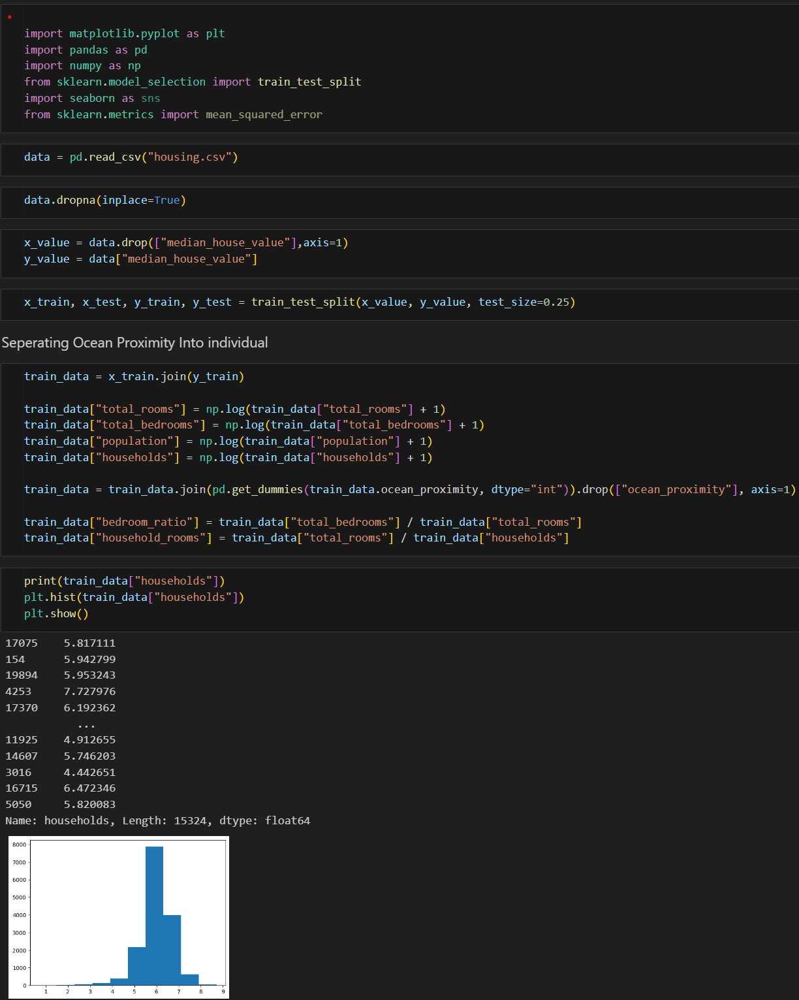
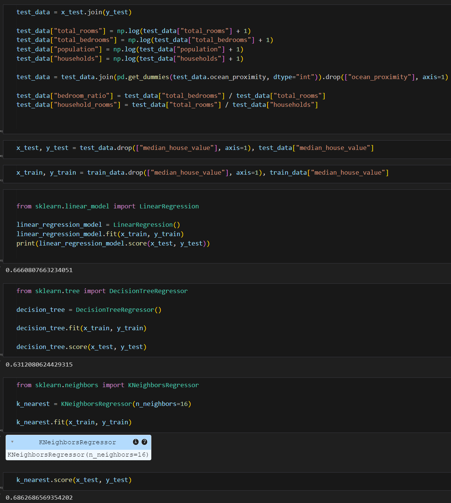

# An Evaluation of Machine Learning

**Research Question:** To What Extent Can Various Supervised Machine Learning Models Predict the Housing Prices in California?

| | |
|---|---|
| **Registered Subject** | Computer Science |
| **Candidate Code** | kyx418 |
| **Word Count** | 3937 |

## Table of Contents

1. [Introduction](#1-introduction)
   - [1.1 Context and Background](#11-context-and-background)
   - [1.2 Scopes and Concepts](#12-scopes-and-concepts)
2. [Background Information](#2-background-information)
   - [2.1 Scope of Research](#21-scope-of-research)
   - [2.2 Choice of Programming Language](#22-choice-of-programming-language)
   - [2.3 Choice of Libraries Used](#23-choice-of-libraries-used)
3. [Data Collection](#3-data-collection)
   - [3.1 Model Evaluation](#31-model-evaluation)
4. [Investigation](#4-investigation)
5. [Findings](#5-investigation-findings)
   - [5.1 Data Limitations](#51-data-limitations)
6. [Analysis](#6-analysis)
   - [6.1 Further Scope of Research](#61-further-scope-of-research)
7. [Works Cited](#7-works-cited)
- [Appendix A: Program Code](#appendix-a-program-code)

---

## 1. Introduction

### 1.1 Context and Background

The housing market in 2024 is crazier than ever before, with prices skyrocketing over the past few years (Cruze 2024). With unusual trends in the market, insanely high interest rates, and low housing inventory, it is more important now than ever to make the best financial decisions around housing. Additionally, the consistent increase of housing prices creates a necessity for a procedure that can predict the prices and customs of housing for future years (Alfiyatin, 2017). While real estate professionals will never be able to predict trends with 100% accuracy (Cruze 2024), there is still a way to be able to associate features and trends with prices for the finest house for your money.

Being able to anticipate the housing prices given varied features and data points is significant in the area of computer science as it can embody a computer's resourcefulness and its pure power to be able to employ predictions previously incomprehensible. Machine learning and the data science field as a whole are current due to the advancement and growth of technology, such as increased capacity and speed that a computer can handle. The ability to apply statistical and mathematical techniques to technology at an extensive scale is one of the most vital fields of data/computer science, which this experiment will reproduce.

### 1.2 Scopes and Concepts

Machine learning is mainly a computational concept, but it consists of statistical knowledge to operate. Machine learning can be defined as a subset or a branch of artificial intelligence and computer science. The main job is to utilize algorithms and patterns to allow AI to learn the way humans do, learning gradually over time (IBM.com). One form of this is linear regression, as it finds the linear relationship between all the given points that gives the least error in between, both of which will be commented on later.

Machine learning is NOT deep learning. The recent “boom” in company applications turning to AI, such as chatbots, are forms of unsupervised learning models or deep learning. These algorithms are capable of interpreting trends and patterns in unlabeled data, which are then transformed into language, images, etc. Deep learning is a subset of machine learning, which needs much more mathematical and statistical expertise than supervised learning, as it can digest unstructured/unlabeled data with little to no human intervention (IBM.com).

Supervised learning models are utilized when trying to predict patterns in labeled data. Data is both labeled for the input and output of the algorithm, and the algorithm's assignment is to create forecasts for the labeled data based on trends it finds in the training sets. The models utilized in this study will all be supervised learning models. These models receive input data and modify its weights until it most appropriately fits. Supervised learning models include linear and logistic regression, random forest, and support vector machines (IBM.com). With the scopes in mind, the purpose of this essay is to demonstrate and find the machine learning model with the most accurate data, which in this circumstance will be the housing prices of California.

Labelled data, as named, creates an association between the data inputted and a specific outcome, such as whether or not a disease is present or if a food is safe or not. The labelled outcome is what supervised models try to predict, utilizing the data given to them. In contrast, unlabeled data points do not have any associated output. This becomes useful for finding hidden trends in data, where an associated output may limit the accuracy of the model. While it can be more accurate, the output is often more difficult to interpret, as there is no label associated with it. In this essay, labeled data will be used to analyze various supervised machine learning models.

## 2. Background Information

With a rapidly expanding population, the necessity of housing has been spiking exponentially, resulting in housing prices increasing year by year. Machine learning is a great way to investigate this phenomenon and enables us to research the correlations between all factors that could be connected to the pricing of a home. Examples of these include: number of bathrooms, distance to water, square footage of housing, bedroom count, etc.

### 2.1 Scope of Research

To find the best way to predict housing prices, there must be consideration from multiple types of machine learning algorithms, as each is steered in its way to find the best possible response. The algorithms that I will be exploring include KNN, linear regression, and decision tree models. I will be conducting the research on my own, upon a Kaggle dataset, *California Housing Prices* (Kaggle.com). There will also be a limitation to my research. The algorithms I will be exploring do not include deep learning concepts, such as neural networking.

### 2.2 Choice of Programming Language

The programming language that I will be utilizing for my research is Python. Python is very easy to learn, quick, and powerful. Additionally, they contribute thousands of third-party libraries for programmers to choose from (Python.org). I will be writing my code using Microsoft’s Visual Studio Code (VSCode) application. VSCode is a fast, locally run, integrated development environment (IDE) that allows easy access to downloadable libraries. Furthermore, VSCode provides the Jupyter notebook library, which is extremely useful for machine learning algorithms as it allows for single line compiling instead of running each line every time you make a change.

### 2.3 Choice of Libraries Used

- **Pandas (`pd`):** Pandas is a library for cleaning and manipulating data. Pandas is crucial for its ability to “clean” data or remove any null values that may skew or break the algorithm during runtime.
- **NumPy (`np`):** This library is used to perform mathematical calculations beyond the standard math library in Python, such as the multiplication of matrices. Because we have various features in the calculation of the housing price, we must have access to multidimensional arrays and calculations that follow.
- **Scikit-learn (`sklearn`):** This library provides simple and easy access to machine learning. Machine learning algorithms are very complex and require large amounts of time to code manually, which is why this library is very important. This library will also be used to separate data into test and train groups to test my research question.
- **Matplotlib (`plt`):** This library is for the representation of data used in machine learning, showing correlations and plotting information used. It creates visualizations, such as charts or graphs, that can be used to interpret data in different ways.

## 3. Data Collection

The dataset that I will be using to answer my research question is called California Housing Prices, found on Kaggle.com. I used this data because it contains various features to help predict a dependent variable and is widely utilized among data scientists to explore machine learning algorithms and data predictions. Below is a 5-row sample from the raw dataset:

| longitude | latitude | housing_median_age | total_rooms | total_bedrooms | population | households | median_income | median_house_value | ocean_proximity |
|---:|---:|---:|---:|---:|---:|---:|---:|---:|:---|
| -122.23 | 37.88 | 41 | 880 | 129 | 322 | 126 | 8.3252 | 452600 | NEAR BAY |
| -122.22 | 37.86 | 21 | 7099 | 1106 | 2401 | 1138 | 8.3014 | 358500 | NEAR BAY |
| -122.24 | 37.85 | 52 | 1467 | 190 | 496 | 177 | 7.2574 | 352100 | NEAR BAY |
| -122.25 | 37.85 | 52 | 1274 | 235 | 558 | 219 | 5.6431 | 341300 | NEAR BAY |
| -122.25 | 37.85 | 52 | 1627 | 280 | 565 | 259 | 3.8462 | 342200 | NEAR BAY |

Before utilizing this data, I removed any rows with null cells using Pandas. This is important because it reduces the probability of errors when running the code and ensures the relationship between the features only contains complete data.

I also separated the ocean proximity feature into multiple columns. Currently, the dataset includes 5 unique texts under the feature: `<1H OCEAN`, `INLAND`, `NEAR OCEAN`, `NEAR BAY`, and `ISLAND`. Because the algorithms only compare numbers, I converted each text into a feature/column, resulting in 5 new columns. Additionally, each row would contain a 1 in the feature for the unique text it previously had and a 0 for the rest. This allows me to compare the ocean proximities to the rest of the features.

Lastly, I ensured that the size of the dataset is generously large to ensure generalizability across all of the California population and not just a select region.

### Machine Learning Model: Linear Regression

Linear regression algorithms are one of the most popular algorithms in machine learning because of both the simplicity and the effectiveness of the model. They use classification, or the prediction of a dependent variable based on continuous independent variables or features (Geeksforgeeks.com), to create a model that can predict new or unseen data.

There are two types of linear regression, which are simple linear regression and multiple linear regression. The one that I will be utilizing for my study is multiple linear regression, as it includes multiple independent variables, which can be used to predict the dependent variable of the experiment. Below is the formula for multiple linear regression (geeksforgeeks.com):

$$y = b_0 + b_1 x_1 + b_2 x_2 + \dots + b_n x_n$$

In this formula:

- $y$ is the dependent variable, which in this case is the median housing price.
- $b_0$ is the intercept of the graph.
- $x_1, x_2, \dots, x_n$ are the features or independent variables in the model. The independent variables of this experiment are median house age, total bedrooms, total rooms, households, ocean proximity, median housing income, latitude, and longitude.
- $b_1, b_2, \dots, b_n$ are the coefficients/slopes of the features, which is the machine learning model’s goal to find.

Linear regression is best for finding linear relationships, and the root of finding the coefficients lies in finding the Mean Squared Error (MSE) with the smallest number.

### Machine Learning Model: Decision Trees

Decision trees are essentially if-else statements taken to a larger scale. The goal of a decision tree is to find the purest leaf node. Leaf nodes are the child node of decision nodes, are the final result, and do not require further computation. The purity of a leaf node is determined by the proportion of one class being 1, while all others are 0. All these concepts require explanation, which I will delve further into. I will be using Figure 1 to help explain decision trees, which will be applied to my experiment in further steps.

   
  <em>Figure 1: Decision Tree Visualization</em>

In Figure 1, there are two classes, red and blue. The job of the decision tree is to best predict whether a new, non-existent datapoint is of the red or blue class, based on the parameters and thresholds it creates. Just by looking at the figure, we can see that most data points between -1 and 1 on the x and y axis are of the red class, while all of those outside are the blue class. We are also able to identify that these classes would not be represented or differentiated by a line on the graph, meaning that linear regression would not be effective for this type of dataset.

This type of situation is where decision trees come into play. We can begin with the parent node, which is also known as the root node. A decision node is one of the if-else statements in the decision tree and helps determine future thresholds.

In Figure 1, there is a comparison between two child nodes, one where $x \le 1$ and another where $x > 1$. When $x \le 1$, there are 49 blue dots and 28 red dots. When $x > 1$, there are 33 blue dots and 0 red dots. Now, with this information, we can calculate the entropy of each child node.

Entropy is essentially the randomness of a system (Britannica.org). What this means is that, in the context of computer science and machine learning, the higher the entropy, the higher the impurity of the node, as there are similar probabilities of each data point occurring in a node. Nodes with high entropy are NOT sufficient to separate two different classes.

The equation for entropy is the following:

$$E = -\sum_i p_i \log_2(p_i)$$

$p_i$ is the probability of a class occurring. So for the first decision, $p_i$ of the blue dots is $\frac{49}{77}$, and $p_i$ of the red dots is $\frac{28}{77}$, so the equation for the entropy would be:

$$E = -\frac{49}{77}\log_2\left(\frac{49}{77}\right) - \frac{28}{77}\log_2\left(\frac{28}{77}\right) \approx 0.946$$

This is highly impure, which makes sense because there is a decent probability for both. Using the same equation for the 2nd decision results in an entropy of 0.

With these two entropies, the computer makes one final calculation to determine the information gain, or IG, of the nodes. If the information gain is not greater than that of the parent node, it will not pursue that branch any further. The equation for IG is:

$$IG = E(\text{parent}) - \sum_i w_i \, E(\text{child}_i)$$

In the equation, $w_i$ is the weight relative to the parent node. For example, if the parent node contains 150 points and the child node represents 50 points, the weight is $\frac{50}{150}$ or $\frac{1}{3}$. The information gain resulted in a positive number, following the equation. Additionally, all of the samples in the node $x > 1$ were of the same class. This is where leaf nodes play a role, simplifying the decision tree and summarizing the decisions made in the path from the root node to where it lies.

Due to limited computational resources, it is important to state that calculating logs for these numbers is very time-consuming and difficult for a computer to handle efficiently. This is why most decision tree algorithms utilize a faster equation, known as the Gini index algorithm. The equation for this is:

$$G = 1 - \sum_i p_i^2$$

This equation provides similar comparisons and helps the computer calculate the information gain of a decision node more efficiently.

Using these formulas, the algorithm parses through each node while looking at one unique feature and keeping track of which decision node results in the greatest information gain. Afterward, it will keep going with the next features until it either finds a perfect result or hits max depth, which leads to the limitations of this model.

### Machine Learning Model: K-Nearest Neighbor (KNN)

KNN is the final machine learning algorithm that I will be exploring. KNN is popular in the data science field for both its simplicity and its accuracy for predicting non-linear trends in data. While it is used for both classification and regression problems, it is more commonly used for classification problems (ibm.com).

The goal of KNN is to identify the nearest neighbors to a given point, and it consists of two processes to do this. First, the algorithm must contain a method to calculate the distance (distance metric) between a given point and $k$ neighbors to create decision boundaries to help sort query points into various regions. There are multiple ways to calculate the distance, with the most common being the Euclidean, Manhattan, and Minkowski distance formulas. The formula I will be experimenting with is the Euclidean distance formula, as it assumes a straight line between the points measured. The Euclidean distance formula also has a smoother gradient than the Manhattan distance formula, which is useful for KNN, which relies heavily on distance-based weighting. The equation for the formula is the following:

$$d(p, q) = \sqrt{\sum_{i=1}^{n} (q_i - p_i)^2}$$

Where:

- $p$ and $q$ are the two data points being compared.
- $p_i$ is the $i$th value for one data point. For example, the point has coordinates such as price, sqft, bedrooms, etc. These are all values of $p$, shown as $(p_1, p_2, \dots, p_n)$.
- $n$ is the number of features that are being compared between two points.

This formula is repeated amongst all values in place of $q$, and the $k$ closest values are classified with the $p$ value given. Because this is a machine learning algorithm, it must also find the ideal $k$ value for the algorithm.

The $k$ value can be crucial to balancing overfitting or underfitting the model. The ideal value of $k$ highly depends on the input data, such as data with more outliers fitting more accurately with higher $k$ values.

### 3.1 Model Evaluation

#### Error Measurement

Because the results from all the models can vary in a manner that is difficult to understand, it is important to include evaluation metrics to compare the results across all models. This will help me better interpret the results and determine the most accurate prediction model. I will be measuring the models’ ability to explain variation in the data between the predicted values and the true values of the dataset, using $R^2$.

$R^2$ explores how well the model fits the data or how well it can explain the variance in the data. $R^2$ is always returned as a value between 0 and 1, meaning a value of 0.6 says that the model can explain the variation of 60% of the data, highlighting the goodness of fit (GOF).

The formula for $R^2$ is the following:

$$R^2 = 1 - \frac{\text{Sum of Squared Residuals}}{\text{Total Sum of Squares}}$$

The $R^2$ evaluation metric is a powerful tool in understanding the models’ accuracy and predictive power concerning the data provided.

## 4. Investigation

1. To conduct the investigation, I am going to split the data into a 9:1 ratio, where 90% of the rows are used to train/fit the model (training data), and the other 10% is used to test the model (testing data).
2. Before splitting the data based on the train and test split, it's necessary to separate the median price from the dataset and form a new dataset containing only the median housing values. The median housing value, labelled as the y value, is the value used to fit the coefficients of the model. The rest of the values are used to predict the y value.
3. There are also some occurrences (rarely) of variables without any value or null values. The absence of these values could break the model or create unexpected results, so the `dropna` method is used to remove any rows with null values. The data will be split using the scikit-learn library, specifically, the `train_test_split` method will be used. The parameters of the method are the variables of each housing town (`x`), the median price of each house (`y`), and the size of the ratio between the test and train data (`test_size`). The `test_size` variable is written as a decimal, where the greatest number it can take is 1 (100%) and the least is 0 (0%). A value of 0.1 will be entered, as the test size is 10% of the total data.

   

      
     <em>Figure 2: First steps, splitting data</em>
   

4. Next, there is a variable called `ocean_proximity`, which contains string values (words) rather than integers. The learning models are not able to understand non-integer values, meaning that this variable will not allow the model to run. Because of this, I have split each unique variable of the `ocean_proximity` into its own column. After this, the dataset will assign a 1 to each variable that matches the value it had and 0 to the rest of the variables. This is possible because there are only 5 unique values that were in the `ocean_proximity` value, thus, there are only 4 extra columns (after removing the ocean proximity value).
5. Certain variables in the x list, such as the total rooms, total bedrooms, population, and households, have sets of data that are not normally distributed, as shown in Figure 3. Bringing values closer to normal distribution can help to slightly increase the accuracy of the model. To bring the data set closer to a normal distribution, I will add 1 to each value and then take the log. Creating a normal distribution may lead to more accurate results due to some models assuming normality already. When the data matches the assumptions, the results tend to be more accurate and reliable.

   

      
     <em>Figure 3: Dataset prior to change</em>
   

   

      
     <em>Figure 4: Dataset after normal distribution change</em>
   

6. Additionally, to show more correlation, I created two new variables in the x list, called bedroom ratio and household rooms, where the bedroom ratio is the total bedrooms divided by the total number of rooms, and the household rooms are total rooms divided by the households.
7. Steps 4 through 6 were conducted on both the training data set and the testing data split, or `train_x` and `test_x`.
8. For determining the accuracy of each machine learning algorithm, I imported the models from the sklearn library, created an instance of the model, fit the model, and then scored the model. Additionally, to reduce any impact of outlying data in the model, I will run each model 5 times, then average the 5 to determine my final result.

## 5. Investigation Findings

When analyzing the findings of the data, it is important to note that the closer the $R^2$ value is to 1, the more accurate it is. Lower $R^2$ values represent less explanatory power of the variation and thus less accuracy in predicting the data overall.

**$R^2$ Value of Supervised Machine Learning Models**

| Trial | Linear Regression | Decision Trees | K-Nearest Neighbor |
|:---:|:---:|:---:|:---:|
| 1 | 0.648 | 0.628 | 0.666 |
| 2 | 0.652 | 0.610 | 0.679 |
| 3 | 0.680 | 0.632 | 0.688 |
| 4 | 0.665 | 0.608 | 0.679 |
| 5 | 0.666 | 0.631 | 0.686 |

### 5.1 Data Limitations

- **Supervised Model Predictiveness:** There is the possibility that there are trends or patterns in the pricing that cannot be predicted using the supervised learning models used in this study. The models are limited to predicting certain patterns with the labelled data given and cannot find any trends outside the given labelled data.
- **Housing Price Randomness:** One of the features of house prices is that there is a level of randomness that simply cannot be predicted by any model whatsoever.
- **Limited Variables:** Because the models were only trained off of a few variables, the predictiveness of the model could be reduced in comparison to if there were more features included. In the future, it could be beneficial to use data sets that include things such as housing quality, size of rooms, etc.

## 6. Analysis

When averaging the results, the linear regression model had an accuracy of 0.66, the decision tree model had an average accuracy of 0.62, and the KNN model had an average accuracy of 0.68 (all rounded to 2 significant figures). With this data, I can conclude that the KNN model was the most accurate in predicting the data and its variation. The linear regression model is the 2nd closest, almost matching the accuracy of KNN, with the decision tree model being the worst for predicting this dataset.

An $R^2$ value of 0.68 is a moderately accurate prediction. It means that there is a moderate to strong correlation between the independent variables and the dependent variable. While it doesn't explain the variation perfectly, it can explain most of it pretty well.

The overall results from my study show that all three models can moderately predict the housing prices based on many features. These models can be used to determine whether the pricing of a house in California is fair or not based on its features but should not be used to ultimately determine the correct price of a house.

### 6.1 Further Scope of Research

One addition I would make to further the accuracy of the models would be to dive into a more detailed analysis of the housing market. While I believe this study did use a good amount of variables, the ecological validity of the results could be greatly increased by including things such as news reports for crime data in the area or the influence of any sort of recession on the housing market overall. These details could make a great difference in the accuracy of the results and would be beneficial to investigate.

Next, the use of unsupervised machine learning models could help detect underlying patterns beyond the labelled data. Linear regression, decision tree, and KNN models are all supervised models that use labelled data to calculate a labelled result. The housing market is very complex and cannot be fully predicted by labeled machine learning models. Unsupervised models, such as neural networks, could be used to determine underlying patterns in the data that supervised learning models cannot find.

Lastly, increasing the sample size could be effective to better generalize the target population. A sample of California’s housing prices was used due to a lack of resources (computing power and storage). Due to this, I cannot conclude that the model can determine the pricing of housing either in the entire US or across the entire world. Increasing the sample size to better match this population could positively affect the generalizability and extend the use beyond California.

## 7. Works Cited

Alfiyatin, Adyan. “Modeling House Price Prediction Using Regression Analysis and Particle Swarm Optimization Case Study: Malang, East Java, Indonesia.” 2017, [researchgate.net](http://www.researchgate.net/publication/320801620_Modeling_House_Price_Prediction_using_Regression_Analysis_and_Particle_Swarm_Optimization_Case_Study_Malang_East_Java_Indonesia).

IBM. “What Is K-Nearest Neighbors (KNN)?” *IBM*, [https://www.ibm.com/topics/knn](https://www.ibm.com/topics/knn). Accessed 13 Jan. 2025.

“ML | Linear Regression.” *GeeksforGeeks*, [https://www.geeksforgeeks.org/ml-linear-regression/](https://www.geeksforgeeks.org/ml-linear-regression/). Accessed 13 Jan. 2025.

“Entropy.” *Encyclopedia Britannica*, [https://www.britannica.com/science/entropy-physics](https://www.britannica.com/science/entropy-physics). Accessed 13 Jan. 2025.

IBM. “What Is Machine Learning?” *IBM*, [https://www.ibm.com/topics/machine-learning](https://www.ibm.com/topics/machine-learning). Accessed 13 Jan. 2025.

Ramsey Solutions. “Housing Market Forecast: Will Home Prices Drop in 2024?” *Ramsey Solutions*, [https://www.ramseysolutions.com/real-estate/housing-market-forecast](https://www.ramseysolutions.com/real-estate/housing-market-forecast). Accessed 13 Jan. 2025.

Nugent, Cam. “California Housing Prices.” *Kaggle*, 24 Nov. 2017, [kaggle.com/datasets/camnugent/california-housing-prices](https://www.kaggle.com/datasets/camnugent/california-housing-prices). Accessed 13 Jan. 2025.

## Appendix A: Program Code

  

  

